# Naksha Muntazamin (NM) & Award Workspace UI/UX Design Specification
## Enterprise Financial Register & Tri-Modal Data Entry Workspaces (1366 × 768)

> [!IMPORTANT]
> **Domain Hierarchy Enforced**: A single Khata frequently contains **multiple distinct Khasra schedule groups** with different legal scopes and claimant entitlements.
> The UI strictly enforces this 4-tier separation:
> $$\text{Award} \longrightarrow \text{Khata} \longrightarrow \text{Khasra Schedule Group} \longrightarrow \text{Individual Claimant Items}$$
> Khasras are displayed **once per Khasra Schedule Group** rather than duplicated across claimant rows or merged into a shared Khata header. Archival `-do-` notations visibly resolve their specific schedule scope.

---

## 1. Executive Summary: Tri-Modal Data Entry Architecture

To transition the LAC platform from backend developer data-loading to daily revenue office operations, both the **Naksha Muntazamin (NM) Workspace** and **Award Master Workspace** provide three cohesive, numbers-first data entry pathways:

```
                                  +---------------------------------------+
                                  |     OFFICER DATA INGESTION SUITE      |
                                  +---------------------------------------+
                                                     |
             +---------------------------------------+---------------------------------------+
             |                                       |                                       |
             v                                       v                                       v
    [1. PDF-Assisted Extraction]             [2. Manual Entry Wizard]              [3. Excel Bulk Ingestion]
  - Side-by-side OCR audit panel           - 3-Step guided drawer flow           - Multi-sheet template (.xlsx)
  - Interactive bounding boxes             - Multi-khasra schedule builder       - 2-pass relational validation
  - Officer acceptance check               - Real-time statutory formulas        - Conflict quarantine engine
             |                                       |                                       |
             +---------------------------------------+---------------------------------------+
                                                     |
                                                     v
                                       [DRAFT STAGING SAFETY GATE]
                                 - Batch tag: EX-2026-B04 / MN-2026-D01
                                 - Unverified status (No auto-approval)
                                 - Officer certification required
                                 - Zero destructive DB overwrites
```

1. **PDF-Assisted Extraction with Human Review**: Interactive dual-pane extraction where OCR/LLM pre-fills records against high-resolution PDF source pages with visual bounding boxes, requiring explicit officer sign-off before committing.
2. **High-Speed Manual Data Entry (Keyboard-Centric)**: Compact, right-docked drawer wizard (540px) allowing fast data entry officers (DEOs) to select or define Khatas and multi-Khasra schedule groups before entering claimant lines with automated Land Acquisition Act (LAA 1894) statutory calculations.
3. **Excel Template Download & Bulk Import Engine**: Formal, multi-sheet Excel workbooks (`.xlsx`) with relational integrity between claimant items and cadastral schedules, supported by an immediate staging validation modal that isolates row-level defects into a downloadable CSV error report.

---

## 2. Relational Excel Template Architecture

The bulk entry architecture abandons fragile single-table spreadsheets in favor of a normalized, 3-sheet workbook structure that preserves cadastral and financial integrity:

### Sheet 1: `NM_Items` (Claimant Entitlements & Financial Ledger)
Contains one row per claimant entitlement. Cadastral parcels are **not repeated here**, preventing duplicate compensation calculations.

| Column Header | Data Type | Required | Description / Constraints |
|---|---|---|---|
| `Item_No` | Integer / String | **Yes** | Unique serial number in the Award (e.g. `10`, `25`, `25A`). Cannot duplicate. |
| `Khata_No` | String | **Yes** | Revenue account identifier (e.g. `4`, `104min`). Must match Sheet 2. |
| `Schedule_Group_ID` | String | **Yes** | **Relational Foreign Key** matching Sheet 2 (e.g. `SCHED-104-B`). |
| `Claimant_Name` | String | **Yes** | Full legal name of claimant (or Gram Sabha / Gaon Sabha). Synthetic demo personas used. |
| `Parentage` | String | Yes | Parentage / spouse relation (e.g. `S/o Sample Parent A`). |
| `Share_Num` | Integer | **Yes** | Share numerator (e.g. `1`, `12`). Must be $\ge 0$. |
| `Share_Denom` | Integer | **Yes** | Share denominator (e.g. `1`, `20660`). Must be $> 0$. |
| `Land_Comp` | Decimal (INR) | **Yes** | Base land compensation for allocated share. |
| `Structure_Val` | Decimal (INR) | No | PWD assessed value for tubewell, boring, trees, or built structures. |
| `Solatium_Pct` | Decimal | No | Defaults to `30.0%` (Sec 23(2)). |
| `Remarks_Note` | String | No | Administrative or red-ink archival notations. |

### Sheet 2: `Khasra_Schedules` (Cadastral Parcel Definition per Schedule Group)
Defines the cadastral parcels belonging to each distinct schedule group within a Khata.

| Column Header | Data Type | Required | Description / Constraints |
|---|---|---|---|
| `Khata_No` | String | **Yes** | Revenue account identifier (e.g. `104min`). |
| `Schedule_Group_ID` | String | **Yes** | **Relational Primary Key** (e.g. `SCHED-104-A`, `SCHED-104-B`). |
| `Schedule_Title` | String | **Yes** | Legal description (e.g. `Gram Sabha Public Land`, `Proprietary Body Co-sharers`). |
| `Khasra_No` | String | **Yes** | Cadastral parcel identifier (e.g. `2//23`, `6//2`, `7//5/1-2`). |
| `Khasra_Area_BB` | String | **Yes** | Extent in Bigha-Biswa (e.g. `4-16-00`). Strict regex: `^\d+-(0[0-9]|1[0-9])-00$`. |
| `Land_Class` | Enum | **Yes** | Soil classification (`Rosli (Block A)`, `Dakar (Block B)`). |
| `Circle_Rate` | Decimal (INR) | **Yes** | Statutory circle rate per Bigha for this parcel and land class. |

### Sheet 3: `Instructions_ValidValues` (Data Dictionary & Strict Validation Rules)
1. **No Free-Text `-do-` as Keys**: Archival ditto marks must not be written into relational keys. Every row in `NM_Items` must explicitly state its `Schedule_Group_ID`.
2. **Strict Bigha-Biswa Arithmetic**: $1\text{ Bigha} = 20\text{ Biswa}$. Any Biswa value $\ge 20$ (e.g. `5-22-00`) is rejected.
3. **Zero Denominator Prohibition**: Share ratios must have non-zero denominators. Ratios like `0/0` fail pre-import validation.
4. **Schedule Integrity**: Every `Schedule_Group_ID` referenced in `NM_Items` must exist in `Khasra_Schedules`.

---

## 3. Award Master vs. NM Register Distinction

| Feature / Responsibility | Award Master Workspace | Naksha Muntazamin (NM) Workspace |
|---|---|---|
| **Primary Domain Unit** | Cadastral Parcels (Khasras) | Financial Accounts & Claimants (Khatas & Items) |
| **Cadastral Authority** | Validates against **Village Master** (Total survey area) | Validates against **Awarded Area** in Award Master |
| **Scope of Data** | Gazette Sec 4 date, Award date, Possession dates, Rates | Share fractions, Soil rates, Solatium, Interest, Structural costs |
| **Validation Failure** | Area exceeds Village Master boundary or unknown parcel | Invalid share fraction, unknown schedule, missing claimant |
| **Import Target** | `AwardKhasras` table | `NmEntitlements` and `NmEntitlementKhasras` tables |

---

## 4. Visual Evidence: 16 Interactive Desktop States (1366 × 768)

All 16 states have been captured using Playwright Chromium at the exact target resolution of **1366 &times; 768** with zero page-level scroll.

````carousel
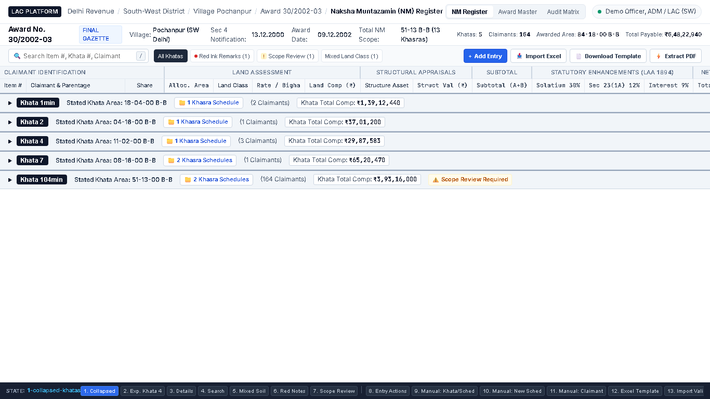
<!-- slide -->
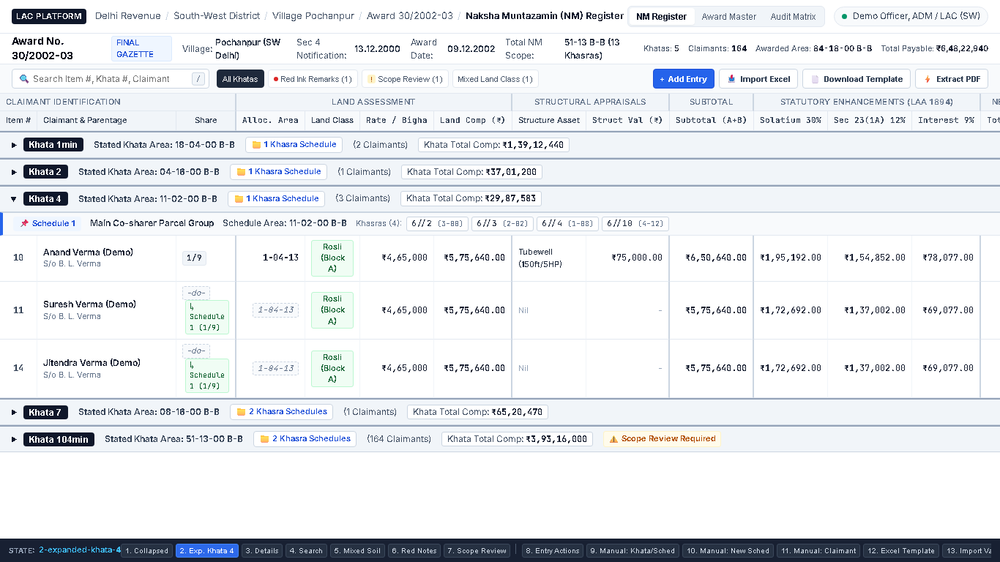
<!-- slide -->
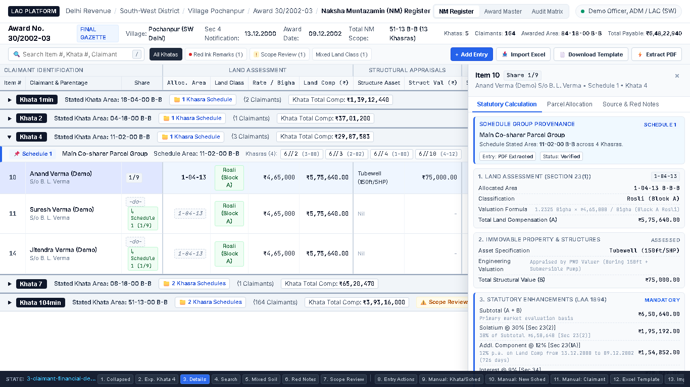
<!-- slide -->
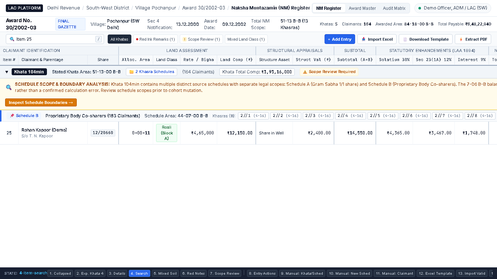
<!-- slide -->
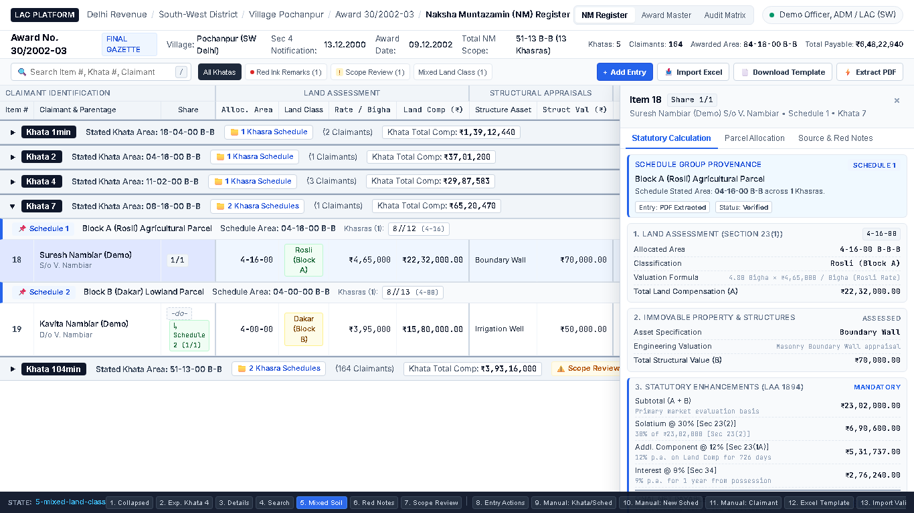
<!-- slide -->
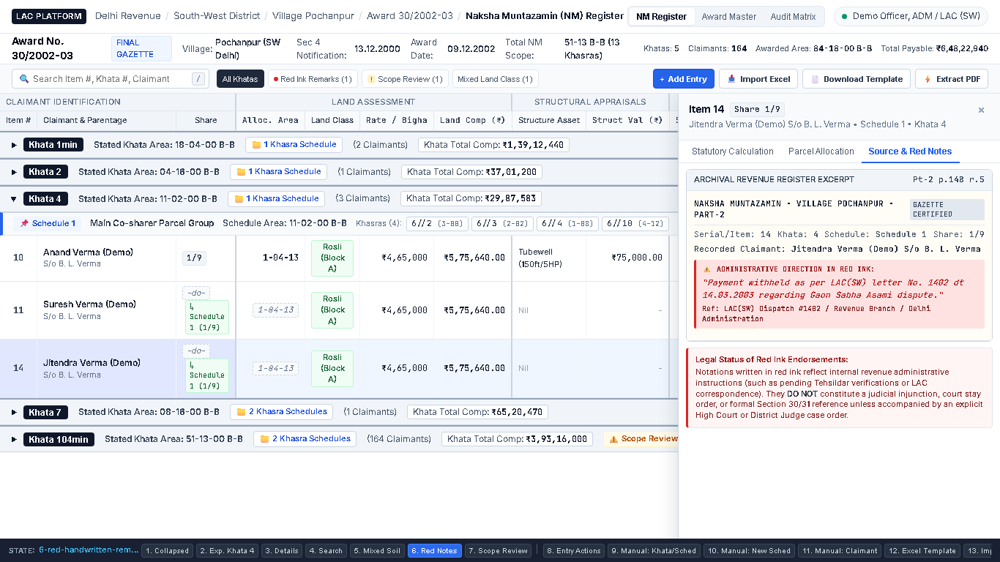
<!-- slide -->
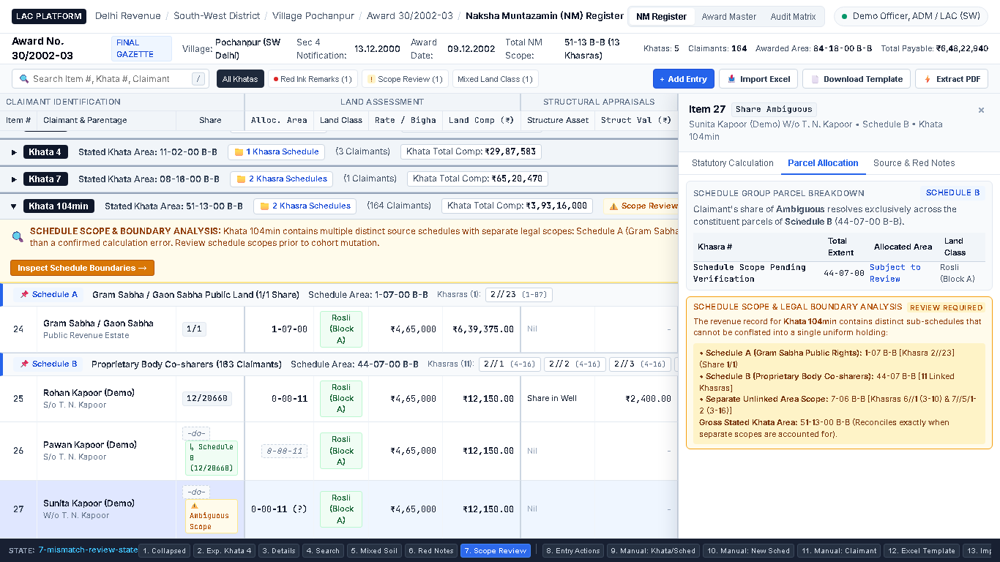
<!-- slide -->
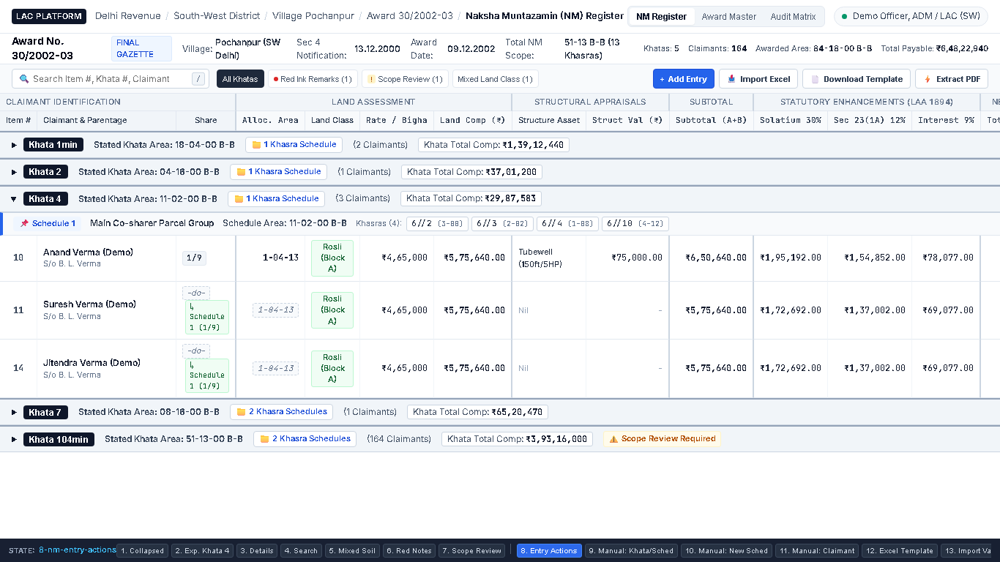
<!-- slide -->
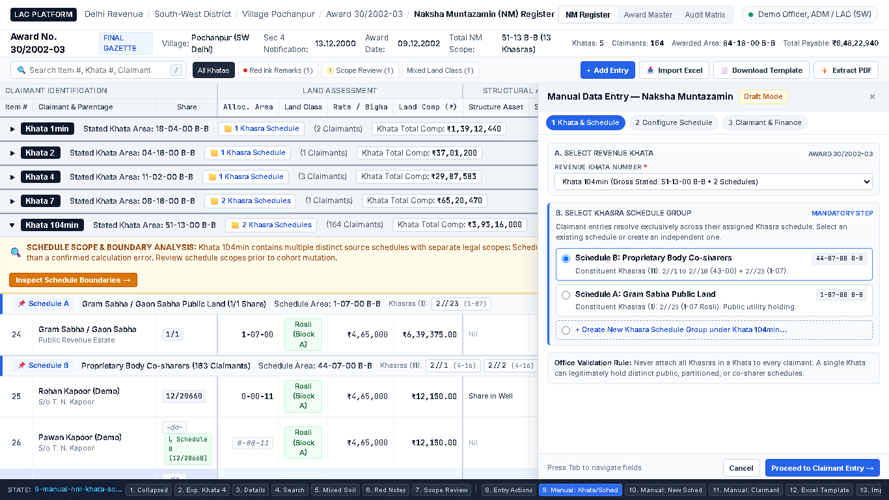
<!-- slide -->
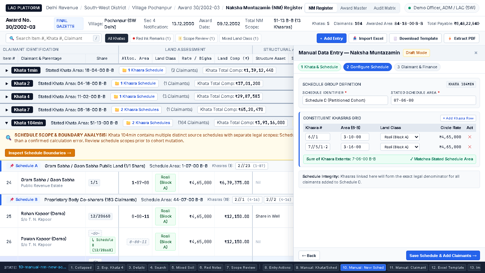
<!-- slide -->
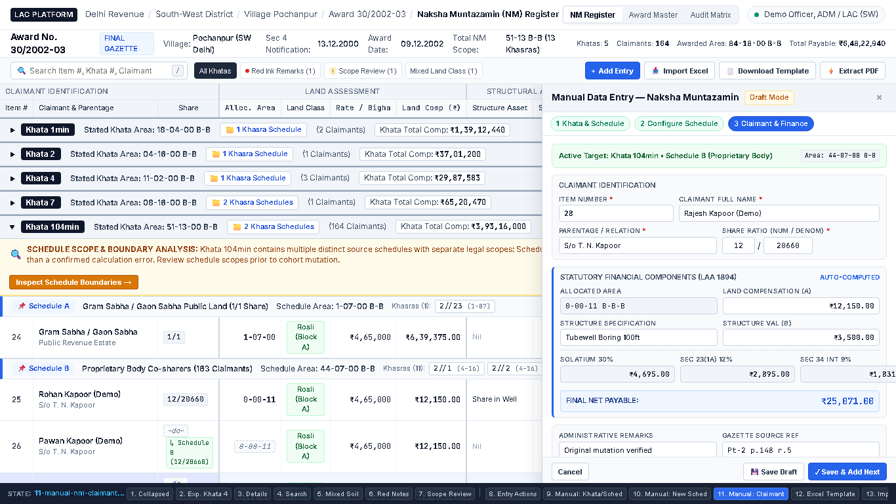
<!-- slide -->
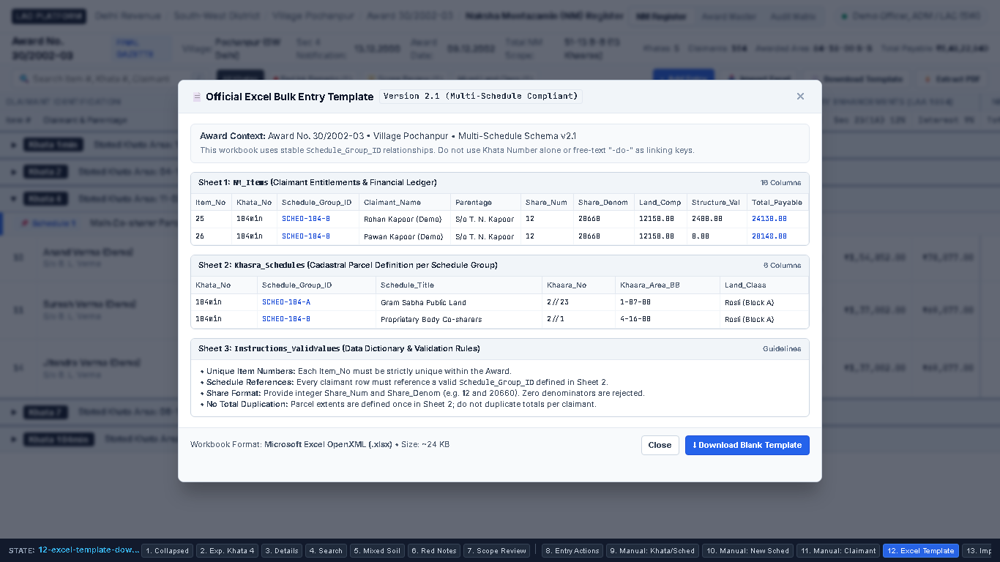
<!-- slide -->
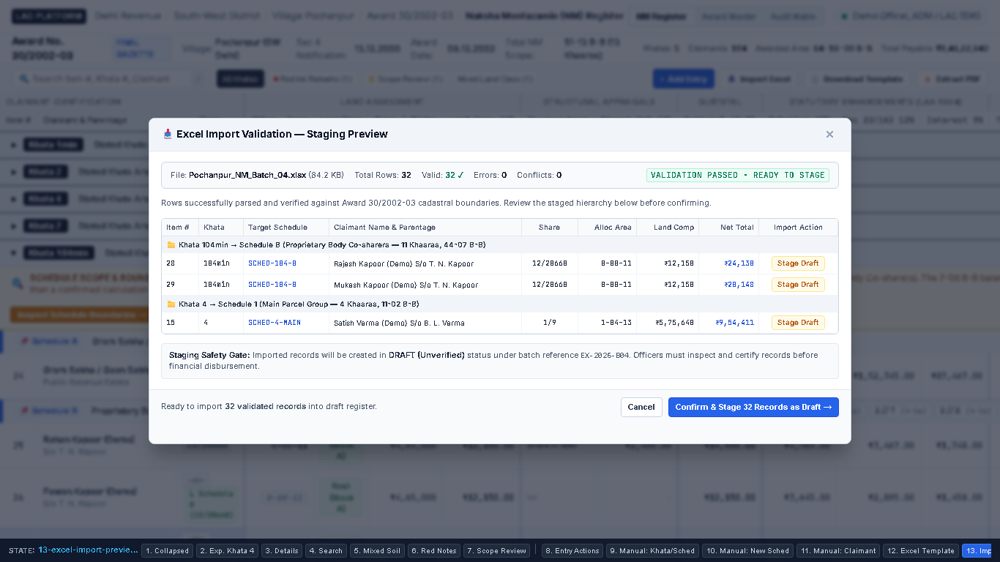
<!-- slide -->
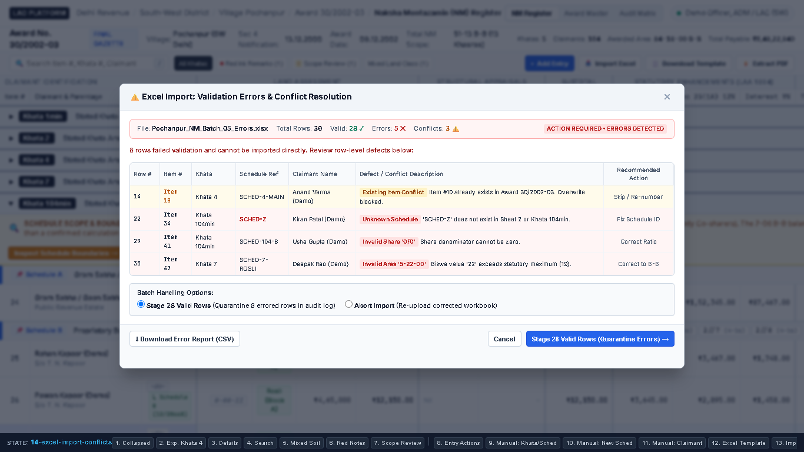
<!-- slide -->
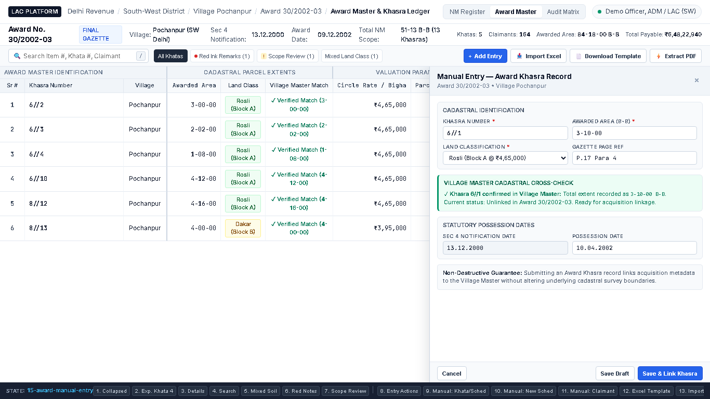
<!-- slide -->
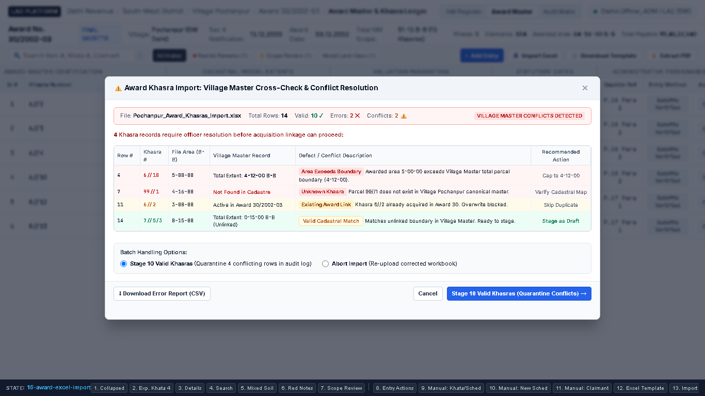
````

---

## 5. Comprehensive State Directory & Artifact Index

| State # | State Identifier | Viewport & Workflow Mode | Key Architectural Features Demonstrated | Direct Screenshot Link |
|:---:|---|---|---|:---:|
| **1** | `1-collapsed-khatas` | NM Register (Master) | Collapsed Khatas 1, 2, 4, 7, 104min. Schedule counts shown (`📁 2 Khasra Schedules`). Zero Khasras in Khata header. | [`1-collapsed-khatas.png`](./screenshots/1-collapsed-khatas.png) |
| **2** | `2-expanded-khata-4` | NM Register (Expanded) | Nested `Schedule 1` header with Khasras `6//2`, `6//3`, `6//4`, `6//10`. Items 10 & 11 show explicit `-do-` resolution `[↳ Sched 1 (1/9)]`. | [`2-expanded-khata-4.png`](./screenshots/2-expanded-khata-4.png) |
| **3** | `3-claimant-financial-details` | NM Register + Drawer | Drawer shows schedule provenance (`Schedule 1`). Item 10 statutory calculation cards: Land Comp ₹5,75,640, Structure Tubewell ₹75,000, Solatium 30%, Sec 23(1A), Sec 34. | [`3-claimant-financial-details.png`](./screenshots/3-claimant-financial-details.png) |
| **4** | `4-item-search` | NM Register (Filtered) | Search for `Item 25`. Table filters down showing `Khata 104min` &rarr; `Schedule B` &rarr; Item 25 (Rohan Kapoor (Demo), 12/20660). | [`4-item-search.png`](./screenshots/4-item-search.png) |
| **5** | `5-mixed-land-class` | NM Register (Soil Split) | Khata 7 shows `Schedule 1` (Rosli Block A, Rate ₹4,65,000, Khasra 8//12) and `Schedule 2` (Dakar Block B, Rate ₹3,95,000, Khasra 8//13) with independent claimant lines. | [`5-mixed-land-class.png`](./screenshots/5-mixed-land-class.png) |
| **6** | `6-red-handwritten-remarks` | NM Register + Inspector | Item 14 selected with red ink badge. Drawer displays archival excerpt with red text note and legal advisory distinguishing administrative directives from court injunctions. | [`6-red-handwritten-remarks.png`](./screenshots/6-red-handwritten-remarks.png) |
| **7** | `7-mismatch-review-state` | NM Register (Scope Audit) | Khata 104min shows Schedule A (Gram Sabha 1/1 share) vs Schedule B (Co-sharers 12/20660). Item 26 resolves inheritance; Item 27 flags `[⚠️ Ambiguous Scope (Needs Review)]`. | [`7-mismatch-review-state.png`](./screenshots/7-mismatch-review-state.png) |
| **8** | `8-nm-entry-actions` | NM Toolbar Actions | Highly discoverable top-right action buttons (`+ Add Entry`, `📥 Import Excel`, `📄 Download Template`, `⚡ Extract PDF`). | [`8-nm-entry-actions.png`](./screenshots/8-nm-entry-actions.png) |
| **9** | `9-manual-nm-khata-schedule` | Manual Entry Drawer (Step 1-2) | 540px entry drawer. Officer selects Revenue Khata (104min) and chooses existing Schedule Group B (44-07 B-B) or creates a new one. Explicit business validation rule displayed. | [`9-manual-nm-khata-schedule.png`](./screenshots/9-manual-nm-khata-schedule.png) |
| **10** | `10-manual-nm-new-schedule` | Manual Entry Drawer (Step 2B) | Schedule Group Definition: Multi-Khasra table grid (`6//1` & `7//5/1-2`). Real-time summation `7-06-00 B-B` matching stated schedule area. | [`10-manual-nm-new-schedule.png`](./screenshots/10-manual-nm-new-schedule.png) |
| **11** | `11-manual-nm-claimant-financial` | Manual Entry Drawer (Step 3) | Item 28 claimant entry: Share ratio `12/20660`, automated calculation of Allocated Area (`0-00-11`), Land Comp (₹12,150), Solatium 30%, Sec 23(1A), Sec 34. Total Net: ₹25,071. "Save Draft & Add Next" rapid action. | [`11-manual-nm-claimant-financial.png`](./screenshots/11-manual-nm-claimant-financial.png) |
| **12** | `12-excel-template-download` | Modal Dialog | 3-sheet structure preview (`NM_Items`, `Khasra_Schedules`, `Instructions_ValidValues`). Displays column definitions, validation rules, and "Download Blank Template (.xlsx)" button. | [`12-excel-template-download.png`](./screenshots/12-excel-template-download.png) |
| **13** | `13-excel-import-preview-valid` | Modal Dialog (Valid Preview) | Ingestion of `Pochanpur_NM_Batch_04.xlsx` (32 valid rows). Displays parsed hierarchy grouped by Khata and Schedule. Highlights `DRAFT / PENDING REVIEW` staging state. | [`13-excel-import-preview-valid.png`](./screenshots/13-excel-import-preview-valid.png) |
| **14** | `14-excel-import-conflicts` | Modal Dialog (Conflict Matrix) | Ingestion of `Pochanpur_NM_Batch_05_Errors.xlsx`. Identifies Row 14 duplicate Item #10, Row 22 unknown schedule `SCHED-Z`, Row 29 zero denominator `0/0`, Row 35 invalid Biswa `5-22-00`. Allows staging valid rows while quarantining defects, with CSV error log export. | [`14-excel-import-conflicts.png`](./screenshots/14-excel-import-conflicts.png) |
| **15** | `15-award-manual-entry` | Award Master + Drawer | Cadastral parcel entry for Khasra `6//1`. Live cross-check against **Village Master** confirms total parcel extent `3-10-00 B-B` as unlinked. Capture of Sec 4 and possession dates. Non-destructive guarantee callout. | [`15-award-manual-entry.png`](./screenshots/15-award-manual-entry.png) |
| **16** | `16-award-excel-import` | Award Master + Modal | Bulk Khasra import validation against Village Master: Flags Row 4 (`6//10`) where awarded area exceeds boundary, Row 7 (`99//1`) unknown in cadastre, Row 11 (`6//2`) already acquired. Shows quarantine options. | [`16-award-excel-import.png`](./screenshots/16-award-excel-import.png) |

---

## 6. Real-Time Statutory Calculation Engine (LAA 1894)

The manual entry drawer and Excel validation engine execute the exact statutory formulas in real-time as users enter share numerators and denominators:

$$\text{Claimant Area (Bigha)} = \frac{\text{Share Numerator}}{\text{Share Denominator}} \times \text{Stated Schedule Area (Bigha)}$$

$$\text{Land Compensation } (A) = \text{Claimant Area (Bigha)} \times \text{Schedule Circle Rate}$$

$$\text{Subtotal } (A + B) = A + \text{Structure Valuation } (B)$$

$$\text{Solatium } [Sec\text{ }23(2)] = 0.30 \times (A + B)$$

$$\text{Additional Compensation } [Sec\text{ }23(1A)] = 0.12 \times A \times \frac{\text{Days from Sec 4 Notification to Award Date}}{365}$$

$$\text{Interest } [Sec\text{ }34] = 0.09 \times (A + B + \text{Solatium}) \times \text{Years from Possession Date to Payment Date}$$

$$\text{Total Net Payable} = (A + B) + \text{Solatium} + Sec\text{ }23(1A) + Sec\text{ }34$$

---

## 7. Operational Safety & Non-Destructive Principles

1. **Strict Staging Isolation**:
   - Neither manual entry nor bulk Excel uploads write directly into active/certified tables.
   - All records are staged into `DRAFT / PENDING REVIEW` state under unique batch audit identifiers (e.g. `EX-2026-B04`).
2. **Conflict Quarantine**:
   - Errored rows (duplicate Item #, unknown schedules, illegal Biswa units) never abort the entire valid dataset; officers can stage valid rows while defective rows are quarantined in an exportable CSV defect report.
3. **Village Master Immutability**:
   - Ingesting Award Khasras or NM Entitlements only links acquisition records to the Village Master; it never mutates historical survey parcels or cadastral map extents.
4. **Environment Isolation**:
   - Prototyped and verified strictly in `anti/nm-register-workspace-ui`.
   - Databases `5432` and `5433` remain completely untouched and frozen. Zero citizen PII published.

---

## 8. Prototype Source Files

- HTML Application Shell: [`./prototype/index.html`](./prototype/index.html)
- High-Density Stylesheet: [`./prototype/style.css`](./prototype/style.css)
- Controller & State Machine: [`./prototype/app.js`](./prototype/app.js)
- Automated Playwright Capture Suite: [`./prototype/capture.js`](./prototype/capture.js)
- Screenshot Directory: [`./screenshots/`](./screenshots/)
